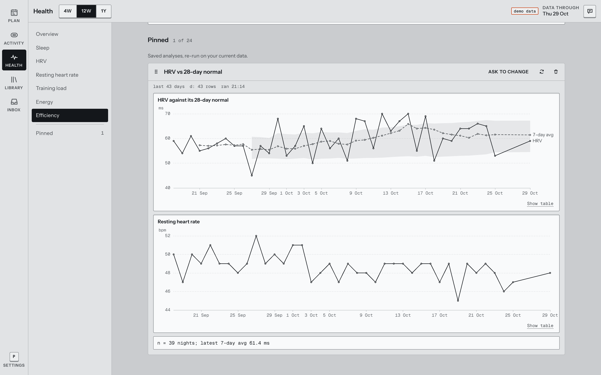

<div align="center">

<h1>Training Studio</h1>

<p><strong>A self-hosted training planner for people who like their data.</strong><br>
Plan your weeks, sync your Garmin, and let an assistant do the heavy planning in plain, editable workouts.</p>

<p>
<a href="#quick-start">Quick start</a> ·
<a href="#features">Features</a> ·
<a href="docs/self-hosting.md">Self-hosting</a> ·
<a href="docs/development.md">Development</a>
</p>

<p>


</p>


</div>

## Why

Most training apps either try to motivate you or lock your data in. I wanted a quiet tool that shows the week at a glance, keeps planned and actual apart, and lets me plan a marathon block by talking it through instead of filling in forms.

Training Studio is built from a few simple pieces: exercises, workouts, repeating series and one Markdown profile about you. Everything is editable by hand. The assistant uses those same pieces, so a 12-week plan it drafts is just 12 weeks of ordinary workouts you can drag, change or delete.

## Features

- **Week and multi-week planning.** Days as rows, one tap to mark a session done, drag and multi-select across weeks, weekly totals per sport.
- **Garmin sync.** Activities, sleep, HRV, resting heart rate and more, pulled on a schedule. Recordings link themselves to the workout they belong to.
- **Activity detail.** Speed and heart rate traces with a window you drag to measure a stretch, laps (400 m by default for skating), splits, bests and the route.
- **Health overview.** Every metric next to your own baseline, with the sample size shown. Missing data stays missing, it is never counted as zero.
- **An assistant that edits your plan.** It reads your calendar, Garmin data and profile. Small changes apply live with Undo, bigger ones arrive as a proposal you preview on the calendar first.
- **Analyses that stay current.** Ask a question about your data, the assistant runs Python in a sandbox and you can pin the chart. It re-runs on fresh data when you open it.
- **Multi-user, private by default.** Invite-only accounts, each with its own SQLite database. Full export and restore.
- **Works on your phone.** Planning happens at a laptop, logging happens right after a session. Both are covered.

<table>
<tr>
<td width="50%"></td>
<td width="50%"></td>
</tr>
<tr>
<td><sub><b>Weeks.</b> The whole block at once, with totals per sport.</sub></td>
<td><sub><b>Activities.</b> Trace, laps, splits and route for every recording.</sub></td>
</tr>
<tr>
<td></td>
<td></td>
</tr>
<tr>
<td><sub><b>Health.</b> Each number next to your own normal.</sub></td>
<td><sub><b>Pinned analyses.</b> Made by the assistant, re-run when you open them.</sub></td>
</tr>
</table>

<details>
<summary><b>See it move</b> (12 seconds)</summary>
<br>

</details>

<details>
<summary><b>On a phone</b></summary>
<br>

</details>

<sub>Screenshots use the built-in synthetic demo data, which is why you see "DEMO" labels.</sub>

## Quick start

You need Docker with the Compose plugin.

```sh
git clone https://github.com/jaccobroere/training-studio.git && cd training-studio
cp .env.example .env        # set OLLAMA_API_KEY to turn on the assistant
docker compose up -d --build
docker compose exec app python -m accounts.admin create yourname
```

Open <http://localhost:8080> and sign in with the temporary password the last command printed. You pick your own password on first sign-in.

To connect Garmin, create a key that encrypts the Garmin tokens at rest, then restart:

```sh
mkdir -p secrets && openssl rand -base64 32 | tr '+/' '-_' > secrets/garmin_token.key
chmod 644 secrets/garmin_token.key && docker compose up -d
```

Then go to Settings → Connections in the app. Keep a copy of that key somewhere safe, like a password manager.

<details>
<summary><b>Running it on a server with HTTPS</b></summary>
<br>

Point a domain at your server and set it in `.env`:

```sh
SITE_ADDRESS=training.example.com
HTTP_PORT=80
HTTPS_PORT=443
```

The bundled Caddy gets a certificate automatically. Running your own reverse proxy instead? See [HTTPS, sessions and reverse proxies](docs/self-hosting.md#https-sessions-and-reverse-proxies).
</details>

<details>
<summary><b>Inviting friends, backups and upgrades</b></summary>
<br>

There is no admin screen and no public sign-up. Everything happens through a small CLI on the server:

```sh
docker compose exec app python -m accounts.admin list
docker compose exec app python -m accounts.admin create alex
docker compose exec app python -m accounts.admin reset-password alex
```

All data lives in one Docker volume: an `auth.db` for accounts and a folder per user with their own database, Garmin files and uploads. `scripts/backup.sh <out-dir>` takes a consistent snapshot of it while the app runs.

Upgrading is `git pull && docker compose up -d --build`. Database migrations run on start.

The full guide is in [docs/self-hosting.md](docs/self-hosting.md).
</details>

## The assistant

The assistant runs on [Ollama Cloud](https://ollama.com) with one API key for the whole server. Without a key the rest of the app works as usual and the assistant tells you it isn't set up.

It's there for the planning that would be tedious by hand: "build me 8 weeks toward a half marathon", "I'm sick this week, move things around", "has my HRV dropped since I added the extra skate session?". It takes image and PDF attachments, can search the web, and runs analyses in a separate sandbox container with no network and no secrets.

What leaves your server: the messages you send, plus the data the assistant reads to answer them. Usage limits per account and per week are set in `.env`.

## How it's built

| | |
|---|---|
| Backend | Python 3.12, FastAPI, SQLite (one database per user), Pydantic AI |
| Frontend | React 19, Vite, TanStack Query, ECharts, Leaflet, plain CSS |
| Sandbox | Same image, separate container, no egress, read-only, resource-limited |
| Proxy | Caddy, serving the frontend and setting security headers |

The design notes are in [`docs/`](docs): what the app is for ([PRODUCT](docs/PRODUCT.md)), the data model ([SIMPLIFY](docs/SIMPLIFY.md)), the decisions behind it ([DECISIONS](docs/DECISIONS.md)), the visual system ([DESIGN](docs/DESIGN.md)) and the API ([API](docs/API.md)).

## Development

```sh
# terminal 1
cd backend && DATA_DIR=/tmp/ts-dev uv run uvicorn main:app --port 8710 --reload
# terminal 2
cd frontend && pnpm install && SPORTS_API=http://127.0.0.1:8710 pnpm exec vite
```

On Linux, `scripts/agent_preview.sh start` spins up a throwaway account with six weeks of synthetic data, which is handy for trying things out. Tests, environment variables and the code layout are in [docs/development.md](docs/development.md).

## Status

I built this for myself and a few friends, and I use it every day. It does that job well, but expect some rough edges if your setup differs from mine. Issues and pull requests are welcome.

## License

[MIT](LICENSE)
