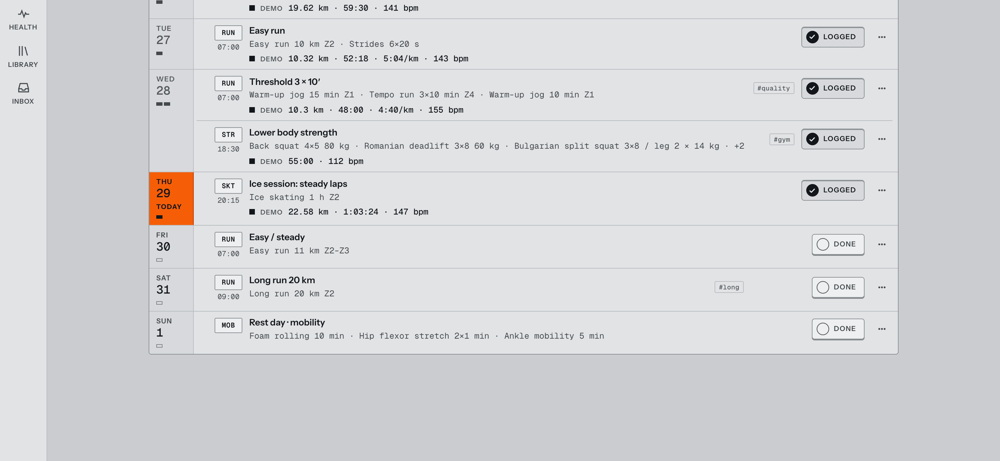
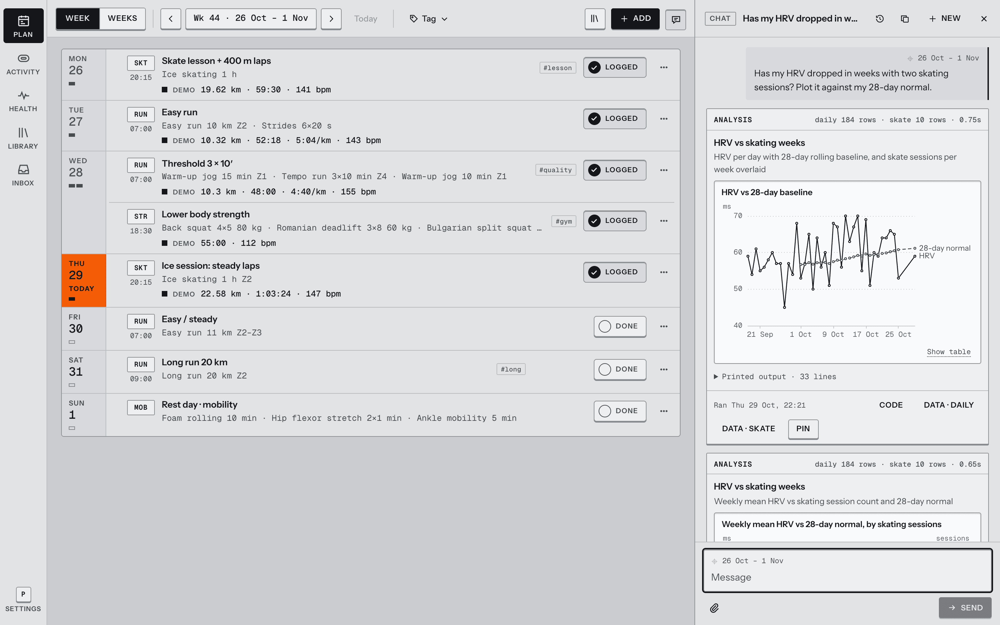
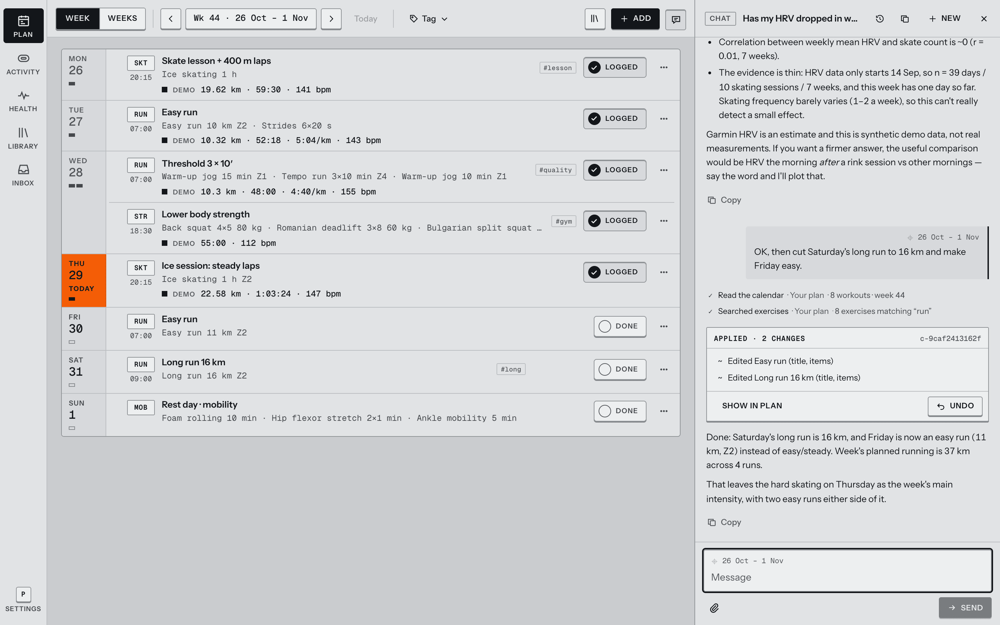
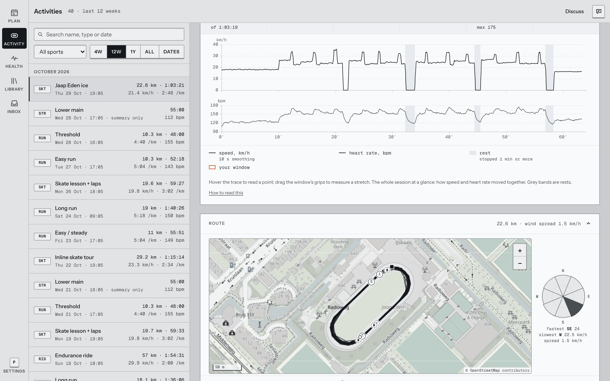
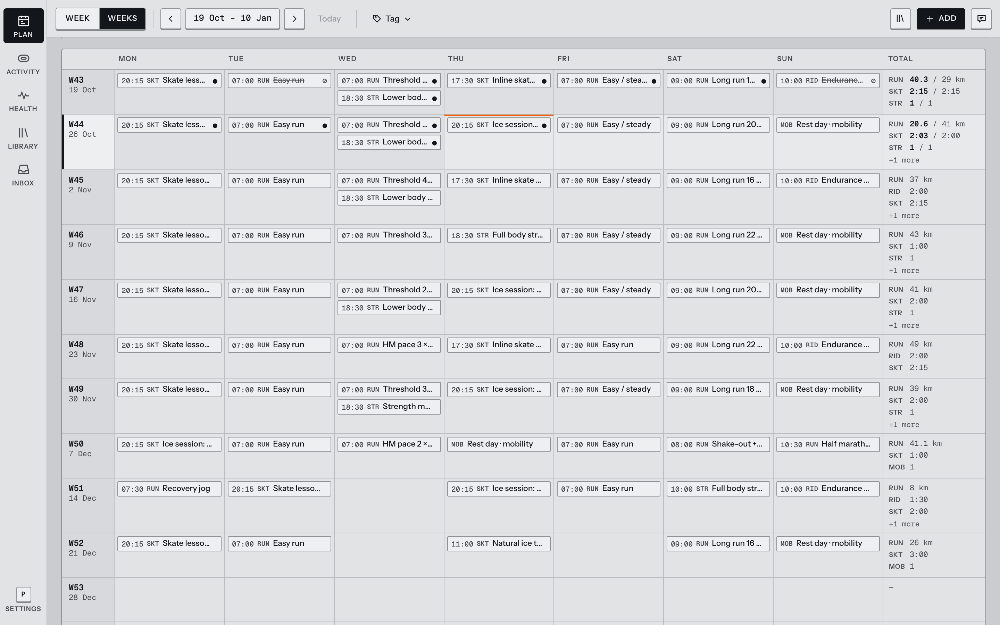
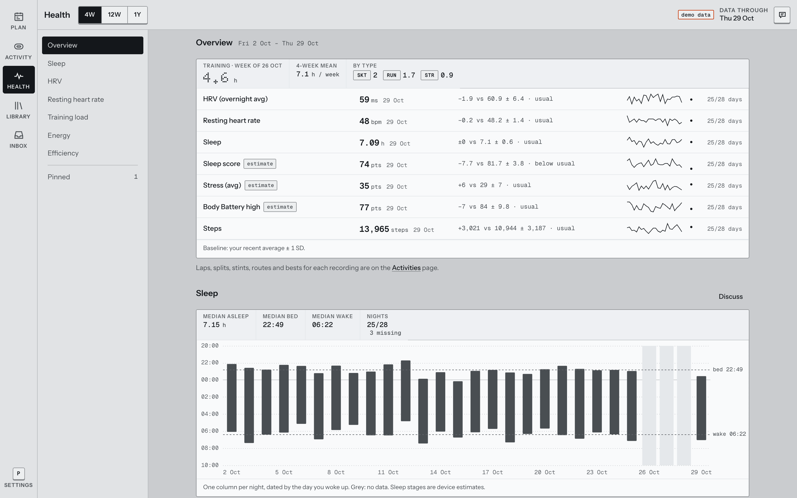
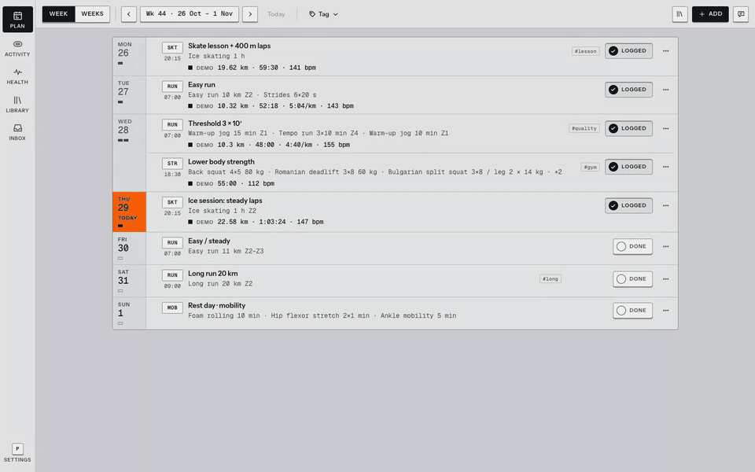
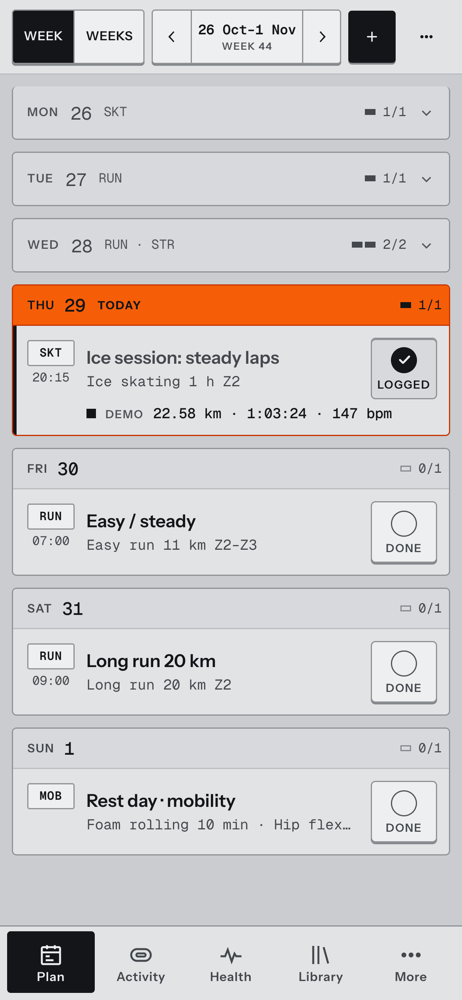

<div align="center">

<h1>Training Studio</h1>

<p><strong>A self-hosted training planner for people who like their data.</strong><br>
Your Garmin syncs in on its own. Plan your weeks, and ask an AI assistant to analyse your data and adjust the plan.</p>

<p>
<a href="#quick-start">Quick start</a> ·
<a href="#talk-to-your-training-data">The assistant</a> ·
<a href="#your-garmin-synced-automatically">Garmin sync</a> ·
<a href="#laps-that-make-sense-on-the-ice">Skating laps</a> ·
<a href="docs/self-hosting.md">Self-hosting</a> ·
<a href="docs/development.md">Development</a>
</p>

<p>


</p>



</div>

## Why

My watch collects years of sleep, HRV, heart rate and training data, and Garmin Connect lets me look at it through a fixed set of charts. I wanted to *ask* it things. Is my HRV lower in weeks with two hard skating sessions? Did my easy pace actually improve this block? What should I drop this week if I slept badly? I wanted an assistant that pulls the data, runs the analysis on the spot, shows me the chart, and then changes my plan if I agree.

The second itch was ice skating. A watch treats a session on a 400 m oval like a run: a few auto-laps, an average pace, done. I wanted every lap from the GPS track, split into blocks between rests, with my fastest lap, my stints above race speed and how heart rate moved with it.

So I built both, on top of a plain training planner. The planner is a few simple pieces: exercises, workouts, repeating series and one Markdown profile about you. The assistant uses those same pieces, so a 12-week plan it drafts is just 12 weeks of ordinary workouts you can drag, change or delete.

## Talk to your training data

The assistant sits in a dock on every page and knows what you are looking at. It is an agent with tools, not a chatbot with a prompt:

| It can | Using |
|---|---|
| Read your plan, history, profile and Garmin data | calendar, activities, daily metrics, inbox and profile tools |
| Run an analysis on the fly | Python in a sandbox container (no network, no secrets) over your daily metrics, sleep, activities, laps and second-by-second streams |
| Keep a chart | pin the analysis to Health, where it re-runs on fresh data every time you open it |
| Change your plan | the same operations the UI uses: small asks apply live with Undo, bigger ones (a whole block, a replan) arrive as a proposal you preview on the calendar |
| Look things up | web search and fetch, plus a built-in coaching guide on intensity, load, tapering and strength |
| Read what you send it | image and PDF attachments, like a plan from your coach or a screenshot of a race result |

Some things it's good at:

> "Has my HRV dropped in weeks with two skating sessions? Plot it against my 28-day normal."
>
> "Build me 8 weeks toward a half marathon on 13 December. Three runs and one gym session a week."
>
> "I slept badly and my legs are heavy. What should I drop this week?"

<table>
<tr>
<td width="50%"></td>
<td width="50%"></td>
</tr>
<tr>
<td><sub><b>Ask a question.</b> It writes and runs the analysis, then shows the chart and the code behind it.</sub></td>
<td><sub><b>Ask for a change.</b> It reads the week, edits the plan live and gives you an Undo.</sub></td>
</tr>
</table>

<sub>A real conversation with the live model, run on the synthetic demo data.</sub>

Every edit the assistant makes is an ordinary change with a diff and an Undo button. It never deletes logged work unless you ask it to.

It runs on [Ollama Cloud](https://ollama.com) with one API key for the whole server. What leaves your server: the messages you send, plus the data the assistant reads to answer them. Usage limits per account and per week are set in `.env`. Without a key the rest of the app works as usual.

## Your Garmin, synced automatically

Connect your Garmin account once in Settings → Connections and forget about it. Every couple of hours the app pulls your new activities and the last few days of sleep, HRV, resting heart rate, stress, Body Battery and steps. No exports, no manual uploads.

- **Recordings find their workout.** A run synced on Tuesday links itself to Tuesday's planned run, so the week shows planned and done side by side without you touching anything. Unclear matches wait in the Inbox.
- **Your history comes along.** Backfill older data from Garmin, or upload a full Garmin data export or loose FIT files.
- **The original files are kept.** Every raw FIT and JSON file is stored before parsing, so new analyses can be computed from old sessions later.
- **Your login stays yours.** Your Garmin password (and MFA code) is used once to sign in and never stored. Only the session tokens are kept, encrypted with a key that lives outside the data volume.
- **You choose the interval**, from every hour to once a day, or turn automatic sync off and sync by hand.

## Laps that make sense on the ice

Every recording gets a full activity view, computed on the server from the raw GPS and heart rate stream:

- **Laps from GPS**, not from the watch: fixed 400 m laps by default, or a lap gate at the point you pass most often, or 200 m, 1 km, device laps.
- **Blocks and rests.** A stop of a minute or more splits the session into blocks, and laps restart after each one, so a warm-up never pollutes your lap times.
- **Stints**: stretches above race speed, with km/h and min/km side by side.
- **A window you drag** across the trace to measure any stretch. It stays in the URL, so you can send someone the exact 3 minutes you mean.
- **Bests, splits and the route** on OpenStreetMap.



It handles watches that don't record every second, and works the same for runs and rides.

## Everything else

- **Week and multi-week planning.** Days as rows, one tap to mark a session done, drag and multi-select across weeks, weekly totals per sport.
- **Health overview.** Every metric next to your own baseline, with the sample size shown. Missing data stays missing, it is never counted as zero.
- **Multi-user, private by default.** Invite-only accounts, each with its own SQLite database. Full export and restore.
- **Works on your phone.** Planning happens at a laptop, logging happens right after a session. Both are covered.

<table>
<tr>
<td width="50%"></td>
<td width="50%"></td>
</tr>
<tr>
<td><sub><b>Weeks.</b> The whole block at once, with totals per sport.</sub></td>
<td><sub><b>Health.</b> Each number next to your own normal.</sub></td>
</tr>
</table>

<details>
<summary><b>See it move</b> (12 seconds)</summary>
<br>

</details>

<details>
<summary><b>On a phone</b></summary>
<br>

</details>

<sub>Screenshots use the built-in synthetic demo data, which is why you see "DEMO" labels.</sub>

## Quick start

You need Docker with the Compose plugin.

```sh
git clone https://github.com/jaccobroere/training-studio.git && cd training-studio
cp .env.example .env        # set OLLAMA_API_KEY to turn on the assistant
docker compose up -d --build
docker compose exec app python -m accounts.admin create yourname
```

Open <http://localhost:8080> and sign in with the temporary password the last command printed. You pick your own password on first sign-in.

To connect Garmin, create a key that encrypts the Garmin tokens at rest, then restart:

```sh
mkdir -p secrets && openssl rand -base64 32 | tr '+/' '-_' > secrets/garmin_token.key
chmod 644 secrets/garmin_token.key && docker compose up -d
```

Then go to Settings → Connections in the app. Keep a copy of that key somewhere safe, like a password manager.

<details>
<summary><b>Running it on a server with HTTPS</b></summary>
<br>

Point a domain at your server and set it in `.env`:

```sh
SITE_ADDRESS=training.example.com
HTTP_PORT=80
HTTPS_PORT=443
```

The bundled Caddy gets a certificate automatically. Running your own reverse proxy instead? See [HTTPS, sessions and reverse proxies](docs/self-hosting.md#https-sessions-and-reverse-proxies).
</details>

<details>
<summary><b>Inviting friends, backups and upgrades</b></summary>
<br>

There is no admin screen and no public sign-up. Everything happens through a small CLI on the server:

```sh
docker compose exec app python -m accounts.admin list
docker compose exec app python -m accounts.admin create alex
docker compose exec app python -m accounts.admin reset-password alex
```

All data lives in one Docker volume: an `auth.db` for accounts and a folder per user with their own database, Garmin files and uploads. `scripts/backup.sh <out-dir>` takes a consistent snapshot of it while the app runs.

Upgrading is `git pull && docker compose up -d --build`. Database migrations run on start.

The full guide is in [docs/self-hosting.md](docs/self-hosting.md).
</details>

## How it's built

| | |
|---|---|
| Backend | Python 3.12, FastAPI, SQLite (one database per user), Pydantic AI |
| Frontend | React 19, Vite, TanStack Query, ECharts, Leaflet, plain CSS |
| Sandbox | Same image, separate container, no egress, read-only, resource-limited |
| Proxy | Caddy, serving the frontend and setting security headers |

The design notes are in [`docs/`](docs): what the app is for ([PRODUCT](docs/PRODUCT.md)), the data model ([SIMPLIFY](docs/SIMPLIFY.md)), the decisions behind it ([DECISIONS](docs/DECISIONS.md)), the visual system ([DESIGN](docs/DESIGN.md)) and the API ([API](docs/API.md)).

## Development

```sh
# terminal 1
cd backend && DATA_DIR=/tmp/ts-dev uv run uvicorn main:app --port 8710 --reload
# terminal 2
cd frontend && pnpm install && SPORTS_API=http://127.0.0.1:8710 pnpm exec vite
```

On Linux, `scripts/agent_preview.sh start` spins up a throwaway account with six weeks of synthetic data, which is handy for trying things out. Tests, environment variables and the code layout are in [docs/development.md](docs/development.md).

## Status

I built this for myself and a few friends, and I use it every day. It does that job well, but expect some rough edges if your setup differs from mine. Issues and pull requests are welcome.

## License

[MIT](LICENSE)
